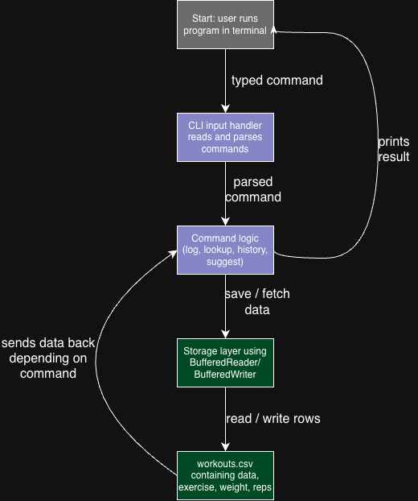

# gym-tracker

A Java command-line tool that logs your sets and instantly shows the weight you used last session.

## The Problem

Every time I'm at the gym, I have to dig through my phone's notes app to find how much weight I used during my last session. For example, if I want to use the leg extension machine, I have to find how much weight I used last time for my sets. Essentially, it is a faster way to look up information without interrupting the workout.

## How It Works

- `log` records a set (exercise, weight, reps, date) to a local CSV file
- `lookup` prints every set from your last session for an exercise
- `history` shows your most recent and your best sets
- `suggest` recommends an increase in your weight by 5 lbs only if every top set hits 10 reps



## Tech Stack

- **Language:** Java 25
- **Libraries:** Java standard library (`java.io`, `java.time`)
- **Data storage:** local CSV file, no external services

## Setup
Requires JDK 25 or newer. Check with `java --version`
```bash
git clone https://github.com/ogawasan311/gym-tracker
cd gym-tracker
mkdir -p out
javac -d out src/*.java
```

Run every code from the `gym-tracker` folder.
Your workout data is saved to `data/workouts.csv`, which is automatically created after logging a set.

## Usage
```
% java -cp out Main log
Exercise: leg extension
Weight (lbs): 225
Reps: 10
Logged: leg extension, 225.0 lbs x 10 reps

% java -cp out Main lookup "leg extension"
Last session for leg extension (2026-11-27):
 225.0 lbs x 10 reps

% java -cp out Main history "leg extension"
Best set for leg extension: 225.0 lbs x 10 reps (2026-11-27)
Recent sets (newest first):
  2026-11-27  225.0 lbs x 10 reps

% java -cp out Main suggest "leg extension"
Last session (2026-11-27):
 225.0 lbs x 10 reps
Suggested next weight for leg extension: 230.0 lbs
```
## Roadmap

- [x] Progressive overload suggestions
- [ ] Edit or delete an incorrect entry
- [ ] Auto-recommend exercise based on history
- [ ] Mobile front end for an app


## Author

Sanshiro Ogawa ([@ogawasan311](https://github.com/ogawasan311))